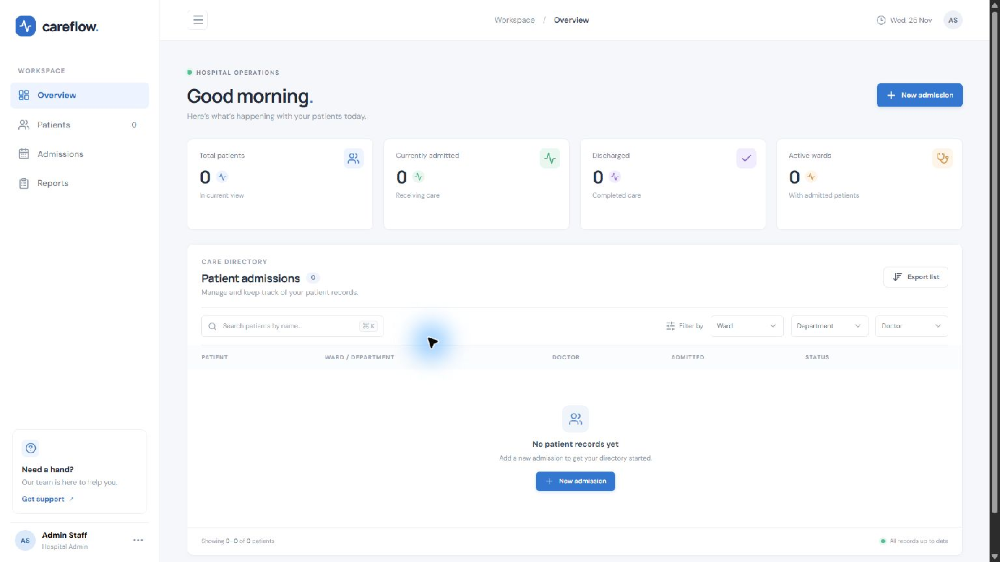

# Careflow — Patient Admission Management

A responsive hospital patient directory built for the DScribe Round 1 task.

## App screenshot



## Project links

- Live application: https://dscribe-patient-admission.onrender.com/
- Public repository: https://github.com/Akanksha987/DScribe

## Tech stack

- Frontend: React with Vite
- Backend: Python 3 standard-library HTTP API
- Database: SQLite locally; PostgreSQL in hosted deployment

## Requirements

- Node.js 20 or newer and npm
- Python 3.10 or newer

## Run locally

In one terminal, start the API:

```powershell
python server/app.py
```

In another terminal, install frontend packages and start Vite:

```powershell
npm install
npm run dev
```

Open the local URL printed by Vite (usually `http://localhost:5173`). Vite proxies `/api` requests to the Python service at `http://localhost:8000`.

The local SQLite database is created automatically. Set `DSCRIBE_DB` to choose another database file, or `PORT` to change the API port.

## Included features

- Add, view, edit, and delete patient admissions
- Search by patient name and filter by ward, department, and doctor
- Mark admitted patients as discharged
- Responsive dashboard and printable/exportable patient list
- Frontend and backend validation for name, age, required selections, and admission date
- Clear API errors for invalid submissions

## API

- `GET /api/patients?search=&ward=&department=&doctor=` — list and filter
- `POST /api/patients` — create a patient
- `PUT /api/patients/{id}` — update a patient
- `PATCH /api/patients/{id}` — mark as discharged
- `DELETE /api/patients/{id}` — delete a patient

## Deploy on Render

The included `Dockerfile` builds the React app and serves it with the Python API from one web service. `render.yaml` configures a free Render service and a `/healthz` health check. For hosted persistence without a paid Render disk, the API switches to PostgreSQL when `DATABASE_URL` is set; SQLite remains the default for local development.

1. In Render, choose **New → Blueprint** and connect this GitHub repository.
2. Review the Blueprint: it creates a free web service and a free Postgres database in Singapore, and connects them through `DATABASE_URL`.
3. Create the Blueprint. Render builds the Docker image and gives you a public `onrender.com` URL. Its free web service may sleep after 15 minutes idle and take about a minute to wake.
4. Open the URL and add a patient. Records are stored in Postgres, so they survive web-service restarts.

**Free-tier limit:** Render deletes free Postgres databases 30 days after creation. This is suitable for a short assignment demo, but migrate the database to a paid plan or another persistent database before relying on it longer. Free-tier limits can change; check Render's current terms. The app's `/healthz` endpoint verifies that the API and database are available.

For local development, the frontend and API run separately as described above. For a local production-style check, build the frontend with `npm run build`, then run `python server/app.py`; the Python service serves both the built frontend and `/api` endpoints on port 8000.
